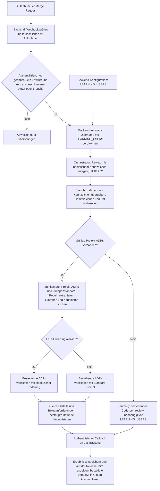

# Code-Review-Agent für GitLab Merge Requests

Dieses Repository enthält den lauffähigen Prototypen aus Kapitel 7 der
Bachelorarbeit. Der Agent prüft neu geöffnete GitLab Merge Requests automatisch
anhand der Projektkonfiguration: Projekte mit gültigen Architecture Decision
Records (ADRs) erhalten einen Architektur-Review gegen Projekt-ADRs und
Gruppenstandards. Projekte ohne gültige Projekt-ADRs erhalten einen
lernfreundlichen Code-Review mit Erklärungen zu konkreten möglichen Bugs.
Mit `LEARNING_USERS` lassen sich auch die Erklärungen bestätigter ADR-Verstöße
für ausgewählte MR-Autoren lernfreundlicher formulieren.

Das System ist ein Forschungsprototyp und kein allgemeines statisches
Analysetool: Ein OpenAI-kompatibles Sprachmodell extrahiert und bewertet Regeln.
Jedes Urteil wird mit Begründung, Belegstellen und Werkzeugprotokoll gespeichert.

## Was das Projekt macht

Der Review-Ablauf besteht aus drei Komponenten:

1. **GitLab** sendet bei einem neu geöffneten Merge Request ein Webhook-Ereignis.
2. **Next.js-Backend** prüft das Webhook-Secret, lädt Merge-Request-Metadaten,
   legt einen Review-Datensatz an und startet die Sandbox im Hintergrund.
3. **Podman-Sandbox** klont den betroffenen Commit, erstellt den Diff und führt
   die passende Architektur- oder Lernanalyse in einem kurzlebigen Container aus. Das Ergebnis
   geht per authentifiziertem Callback zurück an das Backend; anschließend wird
   der Container entfernt.

Die Prüfung läuft in diesen Schritten:

1. Wenn gültige, angenommene ADRs aus `docs/adr/` vorhanden sind, werden sie
   gemeinsam mit dem mitgelieferten Gruppenstandard aus `sandbox/standards/`
   verwendet. Fehlen gültige Projekt-ADRs, wird automatisch der Lernmodus
   aktiviert; Gruppenstandards lösen in diesem Fall keinen Architektur-Review aus.
   ADR-Dateien werden dabei nicht als Prüfgegenstand behandelt und aus dem
   Merge-Request-Diff für die Code-Prüfung ausgeschlossen. Enthält ein MR nur
   ADR-Änderungen oder herausgefiltertes Rauschen, gibt es nichts zu prüfen.
2. Im Architekturmodus werden aus den ADRs MR-unabhängig einzelne, prüfbare Regeln mit
   überprüftem Originalzitat und ADR-Zeilenangabe extrahiert. Ein unabhängiger
   Quellencheck bewertet bis zu zwölf Regeln pro Modellaufruf. Die Triage ordnet
   Regeln anhand von Diffteilen, geänderten Zeilen und möglichen
   Schnittstellenbezügen zu. Eine gemeinsame Suche je Diffteil sammelt
   Verdachtsfälle für mehrere Regeln; eine zusätzliche Integrationssuche
   verbindet mehrere Diffteile und ihre Schnittstellen. Jeder Verdachtsfall
   wird anschließend unabhängig am Originalcode samt Gegenbelegsuche geprüft.
   Erst bestätigte Befunde werden nach gemeinsamer Ursache dedupliziert.
   Nur ein belegter, an einer hinzugefügten oder gelöschten Zeile verankerter Verstoß wird als
   `NC` (nicht konform) gemeldet. Wo kein Verstoß nachgewiesen ist, wird
   konservativ `CIA` (nicht entscheidbar) statt einer unbelegten Aussage über
   die Einhaltung (`C`) verwendet. Reine Löschungen werden am Basisstand gelesen
   und benötigen zusätzlich aktuelle Belege zum verbleibenden Code. Der
   Entscheidungs- und Ausnahmekontext der ADRs bleibt während der Analyse im
   Arbeitsspeicher; er wird nicht für jeden Befund erneut gespeichert.
3. Im Lernmodus wird der Diff an Hunkgrenzen und bei großen Hunks an Zeilengrenzen
   aufgeteilt. Jeder Teil wird mit eigenem Modellkontext und Suchbudget im
   Zusammenhang mit dem **gesamten ausgecheckten Repository** untersucht. Die
   Werkzeuge können auch unveränderte Dateien, Aufrufer, Imports, Routen,
   API-Verträge, Tests und Konfiguration lesen. Danach prüft ein eigener
   bedarfsgesteuerter Integrationsdurchlauf dateiübergreifende Verbindungen anhand kompakter
   Teilberichte und gezielt nachgeladener Originalstellen. Gesammelte Kandidaten
   werden einzeln gegen den Originalcode verifiziert, einschließlich einer Suche
   nach Gegenbelegen. Der Verifikationsdurchlauf formuliert bereits den fertigen,
   lernfreundlichen Kommentar. Nach der ursachenbasierten Dublettenprüfung werden
   die geprüften Angaben direkt übernommen. Jeder Hinweis muss auf eine
   hinzugefügte oder gelöschte Diff-Zeile zurückführbar sein; die Verifikation muss die betroffene
   Stelle und erforderliche repo-übergreifende Belege tatsächlich gelesen haben.
   Hinweise erklären eine mögliche Folge und enthalten einen konkreten,
   direkt umsetzbaren Verbesserungsvorschlag; bei Bedarf nennen sie auch einen
   passenden Regressionstest. Reine Stilpräferenzen ohne konkreten Nachteil werden
   nicht gemeldet. Fehler einzelner Analysen werden separat erfasst; erfolgreiche
   Teilergebnisse bleiben für die folgenden Phasen erhalten.
4. Im Architekturmodus werden `NC`-Befunde einzeln an ihrer bestätigten
   geänderten Zeile platziert, mit ADR-Grundlage, Folge und Verbesserungsvorschlag. Im Lernmodus
    werden konkrete Hinweise mit möglicher Folge und Verbesserungsvorschlag
    einzeln veröffentlicht; die Kommentare sind ausdrücklich
   nicht blockierend. Befunde erscheinen, sofern möglich, als Inline-
   Diskussion an geänderten Zeilen. Andere Befunde sowie
   Werkzeugprotokolle und Laufdetails sind auf der Review-Seite des Backends
   einsehbar. Ein Sammelkommentar im Merge Request verlinkt auf diese Seite.

Der Webhook antwortet mit HTTP `202`, ohne auf den mehrminütigen Prüflauf zu
warten. Dadurch blockiert der Review keine CI/CD-Pipeline. Ausgelöst werden nur
neu geöffnete Merge Requests (`action: open`); Entwürfe, automatisierte MRs und
andere Aktionen werden ignoriert.

## Voraussetzungen

- Node.js **20.9 oder neuer** (empfohlen: Node.js 22) und npm
- Podman für den Sandbox-Container
- Zugriff auf eine GitLab-Instanz und ein GitLab-Token mit Leserechten auf die
  Projekte sowie Rechten zum Erstellen und Löschen von Merge-Request-Notizen und
  Diskussionen
- ein OpenAI-kompatibles LLM-Gateway und ein dort verfügbares Modell
- Netzwerkzugriff des Backends auf GitLab und das LLM-Gateway; Netzwerkzugriff
  des Containers auf GitLab, das LLM-Gateway und die Callback-URL des Backends

## Einrichtung und Start

### Start mit Podman Compose

Die Anwendung kann mit Podman Compose gestartet werden. Voraussetzung ist ein
laufender Podman-API-Socket auf dem Host; die App verwendet ihn, um für Reviews
die kurzlebigen Sandbox-Container zu erzeugen. Der Socket-Zugriff verleiht der
Anwendung weitreichende Rechte auf dem Podman-Host und sollte daher nur in einer
vertrauenswürdigen Umgebung aktiviert werden.

```bash
cp .env.example .env
systemctl --user enable --now podman.socket
```

Die Compose-Datei verwendet den rootless Socket unter
`$XDG_RUNTIME_DIR/podman/podman.sock`. Für Compose setzt die Datei
`SANDBOX_CALLBACK_BASE_URL` auf `http://app:5000`: Die App und jede Review-Sandbox
verwenden ein gemeinsames, benanntes Podman-Netzwerk (`adr-review`). So läuft
der Callback intern und ist unabhängig von öffentlichem DNS, VM-Port und
Portweiterleitung. Für Links in GitLab-Kommentaren verwendet die App
`PUBLIC_BASE_URL` oder, wenn dieser Wert fehlt bzw. leer ist, den
Wert von `CALLBACK_BASE_URL` aus `.env`. Eine HTTP-URL ohne Portangabe verwendet
Port **80**. Starte und baue alles als derselbe
Benutzer – **ohne `sudo`** –, damit App, Sandbox-Image und Socket dieselbe
Podman-Instanz verwenden. Trage anschließend die erforderlichen GitLab-,
Webhook- und LLM-Werte in `.env` ein. Zum Starten:

```bash
podman compose up --build -d
```

Compose baut dabei sowohl das App-Image als auch das Sandbox-Image. Die App
lauscht im Container auf Port **5000**; rootless Podman veröffentlicht sie
standardmäßig auf VM-Port **80** (`80:5000`). Da Port 80 für deinen User
freigegeben ist, kann rootless Podman ihn direkt binden. Richte das externe
Portforwarding so ein, dass `localhost:80` an VM-Port **80** weitergeleitet
wird. Reviews und Logs bleiben in `data/` und `logs/` auf dem Host erhalten.
Zum Stoppen genügt
`podman compose down`; die persistenten Daten werden dabei nicht gelöscht.

Mit `APP_PORT` lässt sich bei Bedarf der VM-Port ändern; das externe
Portforwarding muss dann auf diesen Port zeigen.

### 1. Voraussetzungen installieren

Im Projektverzeichnis die Abhängigkeiten installieren und eine lokale
Konfigurationsdatei anlegen:

```bash
npm ci
cp .env.example .env.local
```

`.env.local` enthält Zugangsdaten und wird nicht in Git eingecheckt. Trage dort
mindestens folgende Werte ein:

| Variable | Bedeutung |
| --- | --- |
| `GITLAB_HOST` / `GITLAB_TOKEN` | GitLab-URL und Zugriffstoken für eine Instanz; alternativ `GITLAB_CONNECTIONS` verwenden |
| `GITLAB_CONNECTIONS` | JSON-Liste mehrerer Verbindungen mit `host`, `token` und optional `projects`; wenn gesetzt, ersetzt sie `GITLAB_HOST` / `GITLAB_TOKEN` |
| `GITLAB_WEBHOOK_SECRET` | Langes, zufälliges Geheimnis zur Prüfung eingehender GitLab-Webhooks |
| `LLM_BASE_URL` | Basis-URL des OpenAI-kompatiblen Modell-Gateways, inklusive `/v1` falls erforderlich |
| `LLM_API_KEY` | API-Schlüssel für das Modell-Gateway |
| `LLM_MODEL` | Modellname, den das Gateway erwartet |
| `PUBLIC_BASE_URL` | Im Browser und von GitLab erreichbare Backend-URL für Webhook und Links in Kommentaren |
| `CALLBACK_BASE_URL` | Vom Sandbox-Container erreichbare Backend-URL für Ergebnis-Callbacks |
| `SANDBOX_CALLBACK_BASE_URL` | Optionaler Vorrang für Sandbox-Callbacks; Compose setzt hier die interne Container-Adresse |

Ein Webhook-Secret lässt sich beispielsweise so erzeugen:

```bash
openssl rand -hex 32
```

Für lokale Tests muss GitLab den Entwicklungsrechner erreichen können. Dazu
kann ein HTTPS-Tunnel verwendet werden. Trage dessen öffentliche URL als
`PUBLIC_BASE_URL` ein, zum Beispiel `https://beispiel-tunnel.example`; die
Webhook-URL lautet dann `https://beispiel-tunnel.example/api/gitlab/webhook`.
Der Wert von `CALLBACK_BASE_URL` muss aus dem Sandbox-Container erreichbar sein.
Bei Podman ist `host.containers.internal` häufig geeignet; verwende den Host und
Port, die in deiner Umgebung erreichbar sind. Backend und Container müssen GitLab und
das LLM-Gateway erreichen können; der Container muss außerdem die
`CALLBACK_BASE_URL` erreichen.

### 2. GitLab-Zugang konfigurieren

Für eine einzelne GitLab-Instanz genügt ein Token, das auf alle zu prüfenden
Projekte zugreifen darf und Merge-Request-Diskussionen erstellen und löschen
kann. Für mehrere Instanzen oder unterschiedliche Token pro Projekt verwende
`GITLAB_CONNECTIONS`. Definiere **entweder** `GITLAB_CONNECTIONS` **oder**
`GITLAB_HOST`/`GITLAB_TOKEN`. Das JSON kommt als einzeiliger Wert in `.env.local`;
einfache Anführungszeichen außen schützen den Wert vor Shell- und dotenv-Parsing:

```env
GITLAB_CONNECTIONS='[{"host":"https://gitlab.example.com","token":"<TOKEN_A>","projects":["group/project-a","group/project-b"]},{"host":"https://gitlab.example.com","token":"<TOKEN_B>","projects":["other-group/project-c"]},{"host":"https://gitlab.other.net","token":"<TOKEN_C>"}]'
```

`host` ist die GitLab-Basis-URL. `projects` enthält Projektpfade relativ zu
diesem Host (zum Beispiel `gruppe/projekt`) oder vollständige HTTP(S)-URLs.
Ohne `projects` gilt der Token für alle Repositories auf dem angegebenen Host.
Für verschiedene Tokens auf derselben Instanz müssen die Projekte explizit und
ohne Überschneidung zugeordnet werden. Die Protokolle HTTP und HTTPS gelten bei
der Zuordnung als derselbe Host. Beim Setzen von `GITLAB_CONNECTIONS` werden die
Einzelvariablen `GITLAB_HOST` und `GITLAB_TOKEN` nicht als zusätzlicher Fallback
verwendet.

### 3. Sandbox bauen und Anwendung starten

Das Sandbox-Image muss nach der Konfiguration einmal gebaut werden:

```bash
npm run sandbox:build
npm run dev
```

Der Entwicklungsserver stellt die Oberfläche standardmäßig unter
<http://localhost:3000> bereit. Lasse den Prozess während der Nutzung laufen.
Wenn du Werte in `.env.local` änderst, starte den Server neu.

Für einen Produktionsstart:

```bash
npm run sandbox:build
npm run build
npm start
```

Setze in der Produktionsumgebung dieselben erforderlichen Variablen wie in
`.env.local`. `PUBLIC_BASE_URL` muss die von GitLab erreichbare Produktions-URL
sein. Stelle außerdem sicher, dass Podman verfügbar ist und das gebaute
Sandbox-Image auf dem Host vorhanden ist.

## GitLab-Webhook einrichten

Damit GitLab das lokale Backend erreichen kann, muss es unter einer von GitLab
erreichbaren URL laufen. Für lokale Entwicklung kann dafür ein geeigneter
Tunnel oder eine Entwicklungsumgebung verwendet werden. Trage diese URL als
`PUBLIC_BASE_URL` ein. Die URL in `CALLBACK_BASE_URL` muss dagegen aus dem
Sandbox-Container erreichbar sein.

Lege für **jedes GitLab-Projekt**, dessen Merge Requests geprüft werden sollen,
unter **Settings → Webhooks** einen Webhook an:

- **URL:** `<PUBLIC_BASE_URL>/api/gitlab/webhook`
- **Secret token:** derselbe Wert wie `GITLAB_WEBHOOK_SECRET`
- **Trigger:** *Merge request events*
- Bei einer HTTPS-URL sollte *Enable SSL verification* aktiviert bleiben.

GitLab muss den Webhook erfolgreich zustellen können. Prüfe nach dem Speichern
unter **Settings → Webhooks** mit **Test → Merge request events** die Verbindung
und die letzte Zustellung. Der Agent startet eine Prüfung für neu geöffnete,
nicht als Entwurf markierte Merge Requests. Änderungen an bereits geöffneten
Merge Requests und andere Aktionen starten keinen neuen Lauf.

### Automatisierte Merge Requests ausschließen

Vor dem Anlegen eines Reviews werden automatisch übersprungen:

- Quellbranches mit dem Präfix `renovate/` oder `dependabot/`.
- Autoren mit den Benutzernamen `renovate`, `renovate-bot`, `dependabot` oder
  `dependabot-bot` (ohne Beachtung der Groß-/Kleinschreibung).
- Autoren, die GitLab als Bot kennzeichnet (`bot: true`), einschließlich
  Projekt-/Gruppen-Token-Bots. Das Kennzeichen wird bei Bedarf über die Users-API
  geladen, weil es im Webhook normalerweise fehlt. Maßgeblich ist `author_id`
  des Merge Requests, nicht der Benutzer einer späteren Aktion oder eines Commits.

Eigene Automatisierung mit regulären Benutzerkonten ist für GitLab nicht immer
als Bot erkennbar. Ergänze solche Accounts oder abweichende Branch-Präfixe in `.env`:

```dotenv
GITLAB_IGNORED_MR_AUTHORS=svc-dependencies,company-renovate
GITLAB_IGNORED_SOURCE_BRANCH_PREFIXES=automation/,dependency-updates/
```

Beide Listen sind kommagetrennt und ergänzen die eingebauten Ausschlüsse.
Benutzernamen werden exakt verglichen, Branch-Präfixe beachten die
Groß-/Kleinschreibung. Ein menschlicher MR wie `fix/renovate-config` wird allein
wegen dieses Namens nicht ausgeschlossen.

Der Filter gilt vor der Modusauswahl für ADR-Check und Lernmodus. Übersprungene
MRs erhalten HTTP `200` mit `status: ignored` und einem Grund. Sie erzeugen keinen
Review-Datensatz, Container, Modellaufruf oder GitLab-Kommentar; der Grund steht
im vorhandenen, größenbegrenzten `application.log`. Scheitert die Autorenabfrage,
antwortet der Webhook mit HTTP `503`, ohne einen Review zu starten.

### Lernfreundliche ADR-Erklärungen für ausgewählte Autoren

Mit der optionalen Backend-Variable `LEARNING_USERS` erhalten ausgewählte MR-Autoren
verständlichere Erklärungen zu bestätigten ADR-Verstößen. Voraussetzung sind die
oben eingerichteten GitLab-Zugänge, der Merge-Request-Webhook und die Sandbox.

#### Schritt für Schritt aktivieren

1. **GitLab-Benutzernamen ermitteln.** Öffne das GitLab-Profil der gewünschten
   Person, beispielsweise über den Autorenlink eines Merge Requests. Verwende den
   dort als `@username` angezeigten Benutzernamen **ohne das führende `@`**:

   | Im GitLab-Profil | Eintrag in `LEARNING_USERS` |
   | --- | --- |
   | `@anna` | `anna` |
   | `@mustermann.max` | `mustermann.max` |
   | `@neue-kollegin` | `neue-kollegin` |

   Ein Anzeigename wie „Anna Beispiel“ oder eine E-Mail-Adresse eignet sich nicht
   für die Zuordnung. Entscheidend ist der Account des **MR-Autors**.

2. **Im Backend konfigurieren.** Bei Podman Compose bearbeitest du `.env` im
   Projektverzeichnis; beim lokalen Start mit `npm run dev` die `.env.local`.
   `.env.example` ist die Vorlage. Ersetze den leeren Eintrag `LEARNING_USERS=`
   durch die gewünschten Usernames auf einer Zeile:

   ```dotenv
   LEARNING_USERS=anna,mustermann.max,neue-kollegin
   ```

   Die aktive Zeile darf kein `#` am Anfang haben. Trage die Variable nur einmal
   in der jeweiligen Datei ein. Zum Deaktivieren setzt du wieder `LEARNING_USERS=`.

3. **Konfiguration übernehmen.** Beim erstmaligen Einsatz der Funktion müssen
   Backend und Sandbox-Image den aktualisierten Code enthalten. Mit Compose:

   ```bash
   podman compose up --build -d
   ```

   Änderst du danach nur die Benutzernamenliste, genügt es, den App-Container neu
   zu erstellen, damit Compose die Werte aus `.env` erneut einliest:

   ```bash
   podman compose up -d --force-recreate app
   ```

   Ein bloßes `podman compose restart app` übernimmt geänderte Werte aus `env_file`
   nicht. Beim lokalen Entwicklungsstart baust du einmalig das aktualisierte
   Sandbox-Image mit `npm run sandbox:build` und startest `npm run dev` neu.
   Bei späteren Änderungen an `.env.local` genügt der Neustart des Entwicklungsservers.

4. **Einen neuen Merge Request prüfen lassen.** Ein gelisteter Autor öffnet einen
   neuen, nicht als Entwurf markierten MR. Für lernfreundliche **ADR-Erklärungen**
   muss das Projekt gültige, angenommene ADRs unter `docs/adr/` und der MR prüfbare
   Codeänderungen enthalten. Der Webhook bestätigt den Start mit HTTP `202`.
   Den Fortschritt findest du in der Anwendung unter **Merge Requests**. Bei einem
   bestätigten ADR-Verstoß erklärt der Befund die Entscheidung, den Konflikt,
   eine mögliche Folge und eine ADR-konforme Verbesserung. Er erscheint auf der
   Review-Seite und möglichst als Inline-Kommentar in GitLab. Wird kein Verstoß
   bestätigt, gibt es auch keine zusätzliche Lern-Erklärung.

Die Einstellung gilt für **neu angelegte Reviews**. Bereits laufende oder
abgeschlossene Reviews werden durch eine Listenänderung nicht angepasst. Ein
Update oder erneutes Öffnen eines bestehenden MRs löst keinen neuen Review aus.

#### Zuordnung und Verhalten

Der Vergleich ist exakt, aber unabhängig von Groß-/Kleinschreibung; führende und
abschließende Leerzeichen werden entfernt und leere Listeneinträge ignoriert.
Eine fehlende, leere oder nur aus Leerzeichen/Kommas bestehende Variable deaktiviert
die zusätzliche Lern-Erklärung für alle. Maßgeblich ist ausschließlich der über
den bestehenden GitLab-Autoren-Lookup geladene `username` zu `author_id` des MRs,
nicht Anzeigename, E-Mail-Adresse oder auslösender Webhook-Benutzer. Bot- und
Autorenfilter gelten weiterhin vorrangig.

Das Backend speichert die Auswahl als boolesches Kennzeichen am Review und reicht
nur dieses als `ADR_LEARNING_EXPLANATION` an die Sandbox weiter. Die Benutzernamenliste
bleibt im Backend. `ADR_LEARNING_EXPLANATION` ist eine interne Übergabevariable;
für die Einrichtung genügt `LEARNING_USERS`.

Projekte mit gültigen ADRs bleiben im Modus `architecture`. Der bestehende
Verifikationsaufruf formuliert für gelistete Autoren Begründung, mögliche Folge
und Verbesserung in einfacher, didaktischer Sprache: Welche ADR-Entscheidung gilt,
warum die Änderung ihr widerspricht und wie sie ADR-konform verbessert werden kann.
Alle Aussagen müssen durch das ADR und tatsächlich gelesene Belege gestützt sein;
unbelegte Absichten, Risiken und Lösungen dürfen nicht ergänzt werden. Prüfablauf,
Urteile, Beleganforderungen, Modelle und Budgets bleiben erhalten. Es gibt keine
zusätzliche allgemeine Bug-Analyse und keinen zusätzlichen Modellaufruf für die
Erklärung. Die vorhandenen Ergebnisfelder und das Rendering werden verwendet;
pro Erklärungsfeld sind für diese Autoren bis zu 2.400 statt 1.200 Zeichen möglich.

Für nicht gelistete Autoren bleibt der bisherige ADR-Prompt erhalten. Der
automatische Lernreview für Projekte **ohne gültige Projekt-ADRs** funktioniert
unabhängig von `LEARNING_USERS` weiterhin für alle Autoren mit seinen bisherigen
Prompts, Modellen und Budgets.

#### Ablauf vom Webhook bis zum Befund

Das folgende Mermaid-Diagramm zeigt den Datenfluss. GitLab und GitHub stellen den
`mermaid`-Block im gerenderten README als Diagramm dar.



Die beiden ADR-Verifikationszweige sind Alternativen innerhalb desselben
Prüfschritts. Die didaktische Erklärung entsteht direkt in diesem Aufruf.
Ein zusätzlicher Aufruf zum Umformulieren entfällt. Enthält der MR ausschließlich
ADRs oder herausgefiltertes Rauschen, wird keine Codeprüfung gestartet.

## Anwendung bedienen

1. Öffne in GitLab einen neuen Merge Request in einem Projekt, für das Token und
   Webhook eingerichtet sind. Ein MR, der nur ADR-Dateien ändert, wird nicht als
   Code-Review geprüft.
2. Öffne die Weboberfläche und gehe zu **Merge Requests**. Der neue Lauf sollte
   mit dem Status **Warteschlange** oder **In Bearbeitung** erscheinen. Öffne
   den Merge-Request-Eintrag, um die Fortschrittsanzeige zu sehen.
3. Nach Abschluss zeigt die Detailseite die verwendete Regelbasis, Laufzeit und
   geprüften Regeln. `NC` bedeutet, dass eine Regel verletzt wurde, und `CIA`,
   dass sie anhand der verfügbaren Belege nicht entscheidbar war. Klappe die Ergebnisgruppen auf, um Begründung, Belegstellen
   und Diff-Ausschnitte zu lesen.
4. Nur `NC`-Befunde werden als Diskussionen in GitLab veröffentlicht. Wenn ein
   Befund einer geänderten Zeile zugeordnet werden kann, erscheint er inline;
   andernfalls als allgemeine MR-Diskussion. Der Sammelkommentar verlinkt zurück
   auf den vollständigen Bericht in der Anwendung.
5. Bewerte einen Befund auf der Detailseite als hilfreich oder nicht hilfreich.
   Die aggregierten Rückmeldungen findest du im Menü unter **Feedback**.

Die Navigation bietet außerdem **Gruppen-ADRs** zum Nachlesen der aktiven
Gruppenstandards sowie **Monitor → Dashboard** mit Review- und Token-Statistiken
und **Monitor → Error Tracking** für fehlgeschlagene Läufe und Agentenwarnungen.
Die Seite **Monitor → Logs** ist derzeit ein Platzhalter. Die Einstellungen
ändern aktuell nur das Farbschema der Oberfläche; GitLab-Tokens und andere
Serverkonfiguration werden in `.env.local` verwaltet.

Der Dunkelmodus wird sofort umgeschaltet und per Cookie für weitere Besuche
gespeichert. Auch Feedback zu Befunden wird direkt auf der Detailseite gespeichert,
ohne einen Seitenwechsel. Schlägt das Speichern fehl, erscheint eine Fehlermeldung
an der jeweiligen Bedienfläche. Suchbegriffe filtern sofort; mit Enter werden sie
in die URL übernommen und lassen sich damit als Link teilen.

### Betriebsprotokolle

Wichtige Anwendungs- und Containerereignisse werden im Projektordner `logs/`
gespeichert: `application.log` enthält angenommene Reviews sowie Start-, Ende-
und Fehlerereignisse; `containers.log` enthält kompakte Zusammenfassungen und
Fehler aus den Prüf-Containern. Normale Fortschrittsmeldungen und einzelne
Werkzeug-/Modellaufrufe werden nicht in diese Dateien geschrieben. Jede Datei
wird bei 1 MiB rotiert; zusätzlich bleibt jeweils höchstens eine ältere Datei
mit der Endung `.1` erhalten. Zugangsdaten werden vor dem Schreiben maskiert,
und Logdateien sind von Git ausgeschlossen. Beim Serverstart und danach täglich
werden Einträge älter als 14 Tage aus den Anwendungs- und Containerlogs sowie
deren `.1`-Rotationen entfernt. Die Bereinigung betrifft ausschließlich
`logs/`; Review-Daten unter `data/` bleiben erhalten. Zeilen ohne gültigen
Zeitstempel werden zur Sicherheit nicht gelöscht.

### ADR-Check: Laufzeit und Speicherbedarf

Der ADR-Check verwendet einen begrenzten Cache im vorhandenen Datenverzeichnis:

- **Eine Datei:** `data/adr-rule-cache.json` (bzw. unter `DATA_DIR`).
- **Maximal 2 MiB** JSON und **128 ADR-Einträge** insgesamt, nicht pro Projekt.
- **Maximal 64 KiB je Regelpaket**; größere Pakete werden regulär geprüft und
  nicht gecacht. Nur vollständig erfolgreiche Extraktionen werden aufgenommen.
- **30 Tage Gültigkeit**; abgelaufene und am längsten ungenutzte Einträge werden
  bei Cache-Zugriffen automatisch entfernt. Auch ohne weitere Zugriffe bleibt
  der Speicher durch die Größenobergrenze begrenzt.
- Atomare Schreibvorgänge benötigen vorübergehend eine weitere Datei von maximal
  2 MiB. Ein Lock-Verzeichnis verhindert konkurrierende Schreibvorgänge;
  belegter oder nicht verfügbarer Cache bedeutet reguläre Extraktion.
- **Keine zusätzlichen Podman-Volumes, Repository-Klone oder Modellverläufe.**
  Cache-Zugriffe laufen authentifiziert über das vorhandene Backend. Einträge
  sind nach Repository getrennt und enthalten nur Regeln und kurze Quellenzitate.

Änderungen am ADR-Inhalt, Modell, Gateway, Sampling oder an der Extraktionsversion
erzeugen einen neuen Cache-Schlüssel. Die Quellen werden auch bei Cache-Treffern
gegen das aktuelle Dokument validiert. `ADR_RULE_CACHE=0` deaktiviert den Cache;
die Cache-Datei kann bei gestoppter App jederzeit gelöscht werden. Die vorhandene
Review-Historie in `data/reviews/` wird durch diese Cache-Bereinigung nicht gelöscht.

Extraktion und Triage berücksichtigen Bedingungen und Ausnahmen aus dem ADR-Kontext.
Die gemeinsame Suche verwendet Pakete von höchstens acht Regeln und ein zur
Paketgröße passendes Lesebudget (mindestens `BUDGET_FILE_READS`, automatisch bis
zu zwölf). Die Verifikation erhält die betroffene Originalstelle bereits als
protokollierte Dateiöffnung; diese zählt zum Budget. Dubletten werden nach der
Verifikation in kleinen Paketen statt durch einen Modellaufruf je Befundpaar geprüft.

`LLM_FAST_MODEL` kann optional ein Modell für Extraktion, Triage und Dublettenprüfung
festlegen; `LLM_VERIFY_MODEL` eines für die Verifikation. Ohne Angabe gilt jeweils
`LLM_MODEL`. Die Suchphase verwendet weiterhin `LLM_MODEL`.

Die Review-Detailseite zeigt Cache-Treffer und die Laufzeiten von Suche, Integration,
Verifikation und Dublettenprüfung. Im Ergebnis werden außerdem die verwendeten Modelle,
die summierte Dauer erfolgreicher Modellanfragen einschließlich ihrer Wiederholungen
(`modelMs`) und deren Wiederholungszahl (`retries`) gespeichert. Diese summierten
Zeiten sind bei Parallelität nicht mit der Gesamtlaufzeit gleichzusetzen.
Unentschiedene Ergebnisse unterscheiden zwischen einer Suche ohne belegten Verstoß
und unvollständiger Prüfung; kompakte Zugriffszähler ersetzen zusätzliche vollständige
Werkzeugprotokolle für solche Ergebnisse.
ADRs, deren aufbereiteter Kontext 48.000 Bytes überschreitet, werden als nicht
vollständig prüfbar ausgewiesen; Ausnahmen werden nicht still abgeschnitten.

### Lernreview-Budgets

Der Lernmodus untersucht konkrete Bugs und erklärt ihre Ursache und Korrektur.
Er hat eigene Prompts, Integrationsauswahl, Modelle und Laufstatistiken; er verwendet
keine ADR-Regeln und keinen Regel-Cache. Die Modelle lassen sich getrennt einstellen:

- `LEARNING_MODEL`: Suche und Integration; Standard ist `LLM_MODEL`.
- `LEARNING_VERIFY_MODEL`: unabhängige Verifikation samt fertigem Kommentar;
  Standard ist `LEARNING_MODEL` beziehungsweise `LLM_MODEL`.
- `LEARNING_DEDUP_MODEL`: Ursachenvergleich; derselbe Fallback.

Die ADR-Overrides `LLM_FAST_MODEL` und `LLM_VERIFY_MODEL` beeinflussen den Lernmodus
nicht. Die betroffene Originalstelle wird vor dem ersten Verifikationsaufruf geladen
und zählt zum Lesebudget. Es gibt anschließend keinen zusätzlichen Modellaufruf
zum Umformulieren; Titel, Erklärung, Folge und Korrektur stammen aus der Verifikation.

`LEARNING_INTEGRATION_MODE=auto` spart die zweite Suche ausschließlich bei einer
kleinen lokalen Änderung (eine bestehende, weiterhin vorhandene Quelldatei ohne
Umbenennung, ein Diffteil, höchstens 40
geänderte Zeilen und 8.000 Diff-Bytes), wenn die erste Analyse vollständig ist,
keine offenen Fragen meldet und explizit keine weitere Integrationsprüfung benötigt.
Erkennbare Schnittstellen-, Konfigurations- oder Vertragsänderungen sowie mehrere
Dateien/Diffteile erhalten weiterhin eine Integrationsprüfung. `always` aktiviert
diesen Durchlauf für jeden prüfbaren MR, etwa für Qualitäts-Vergleichsläufe.

Auch reine Löschungen werden geprüft: Ein Kandidat benötigt eine tatsächliche
gelöschte Zeile im zugewiesenen Diffteil, gelesene Belege aus dem Basisstand und
zusätzliche aktuelle Belege zum verbleibenden Code. Bestätigte Hinweise werden
an ihrer alten Diffposition veröffentlicht. Ungelesene oder dem falschen Codestand
zugeordnete Zeilen sind keine zulässigen Belege.

Widerlegte und mangels Belegen offene Verdachtsfälle werden getrennt gezählt.
Die Detailseite zeigt Lernphasen, Integrationsentscheidung und unvollständige
Analysen; höchstens zehn offene Beispiele mit je 400 Zeichen Begründung werden
im bestehenden Review-Datensatz gespeichert. Offene Verdachtsfälle erzeugen keinen
GitLab-Kommentar. Zusätzliche Volumes, Caches oder vollständige Zwischenberichte
werden dafür nicht gespeichert.

`LEARNING_CHUNK_BYTES` begrenzt die Größe eines annotierten Diffteils (Standard:
32.000 Bytes, maximal 48.000). Große MRs werden auf mehrere Einheiten verteilt,
statt ab einer globalen Diffgröße abgebrochen zu werden. Eine einzelne Zeile,
die bereits das Teilbudget überschreitet, wird als ungeprüfte Einheit gemeldet.
`LEARNING_CONCURRENCY` begrenzt gleichzeitig laufende Lernanalysen (Standard: 3).
`LEARNING_BUDGET_SEARCH_ROUNDS` und `LEARNING_BUDGET_FILE_READS` gelten jeweils pro
Sammel-, Integrations- oder Verifikationsaufgabe. `LEARNING_MAX_FINDINGS` begrenzt
die Kandidaten pro Sammel-/Integrationspaket (Standard: 20); veröffentlicht werden
die daraus verifizierten, eigenständigen Befunde. Die Gesamtkosten wachsen mit
Diffumfang und Kandidatenzahl; das Sandbox-Zeitlimit gilt weiterhin für den ganzen Lauf.
Die bisherige Variable `LEARNING_MAX_PATCH_BYTES` wird als Fallback für die
Teilgröße berücksichtigt, wenn `LEARNING_CHUNK_BYTES` nicht gesetzt ist.

## Fehlerbehebung

- **Es erscheint kein Review:** Prüfe, ob die letzte GitLab-Webhook-Zustellung
  erfolgreich war, ob `GITLAB_WEBHOOK_SECRET` exakt mit dem Webhook-Secret
  übereinstimmt und ob es sich um einen neu geöffneten, nicht als Entwurf
  markierten MR handelt.
- **GitLab meldet `401` oder `403`:** Prüfe Token, Projektzugriff und die
  erforderlichen API- und MR-Diskussionsrechte. Bei `GITLAB_CONNECTIONS` müssen
  Host und `projects` zur Repository-URL des Webhooks passen.
- **Review schlägt beim Sandbox-Start fehl:** Baue das Image erneut mit
  `npm run sandbox:build` und prüfe, ob Podman installiert und ausführbar ist.
- **`EACCES` beim Schreiben nach `data/` oder `logs/`:** Die Verzeichnisse
  müssen deinem Host-Benutzer gehören, wenn du rootless Podman verwendest. Falls
  sie zuvor mit rootful Podman angelegt wurden, stoppe den Stack und korrigiere
  die Besitzrechte einmalig:

  ```bash
  podman compose down
  sudo chown -R "$(id -u):$(id -g)" data logs
  podman compose up -d
  ```

  Der normale Build und Start laufen danach wieder ohne `sudo`.
- **Der Lauf bleibt hängen oder der Callback schlägt fehl:** Prüfe, ob der
  Container die `CALLBACK_BASE_URL` erreichen kann und ob Backend, LLM-Gateway
  und GitLab aus dem Container erreichbar sind. Die Fehlerdetails stehen bei
  dem Review sowie unter **Monitor → Error Tracking**.
- **Fehler nach Konfigurationsänderungen:** Kontrolliere das JSON in
  `GITLAB_CONNECTIONS`, die URLs und Variablennamen in `.env.local` und starte
  den Next.js-Server neu.

## Entwicklung und Prüfungen

```bash
npm run lint
npm run typecheck
npm test
npm run build
npm --prefix sandbox ci
npm --prefix sandbox run build
```

Die Browser-Regressionstests prüfen Theme-Wechsel, Navigation, Suchfilter,
Feedback, Fortschrittsaktualisierung und API-Validierung:

```bash
npx playwright install chromium
npm run test:e2e
```

Playwright startet einen eigenen Entwicklungsserver auf Port 3147, nutzt
`.next-test/` als Build-Verzeichnis und ein temporäres Datenverzeichnis. Die
Tests benötigen weder GitLab noch ein LLM-Gateway. `tests/contracts.ts` prüft
beim Typecheck zusätzlich, dass Sandbox und Backend dasselbe Ergebnisformat nutzen.

Das Sandbox-Image wird mit `npm run sandbox:build` gebaut. Es enthält den
separaten TypeScript-Prüfkern aus `sandbox/src/` sowie die Gruppenstandards aus
`sandbox/standards/`.

## Projektstruktur

| Pfad | Zweck |
| --- | --- |
| `src/app/api/gitlab/webhook/` | Webhook-Authentifizierung und Auslösung neuer Reviews |
| `src/lib/orchestrator.ts` | Lebenszyklus eines Reviews im Backend |
| `src/lib/sandbox.ts` | Start und Überwachung des Podman-Containers |
| `src/app/api/reviews/[id]/callback/` | Authentifizierter Rückweg der Prüfergebnisse |
| `src/lib/publish.ts`, `src/lib/comment.ts` | Befunde formatieren und in GitLab veröffentlichen |
| `src/app/` | Übersichts- und Detailseiten und HTTP-Endpunkte |
| `src/components/reviews/` | Befundkarten, Diff-Ausschnitte und Review-Kennzahlen |
| `src/components/theme-provider.tsx`, `src/lib/theme.ts` | Gemeinsamer Theme-Zustand und Cookie-Konfiguration |
| `src/lib/store.ts`, `src/lib/keyed-queue.ts` | Atomare JSON-Ablage und serialisierte Schreibzugriffe |
| `src/lib/feedback.ts`, `src/lib/reviews.ts` | Feedback-Verarbeitung und kompakte Review-Ansichten |
| `sandbox/src/checkout.ts` | Repository auschecken und Änderungssatz vorbereiten |
| `sandbox/src/rulebase.ts` | Automatisch Architektur- und Lernmodus wählen; Regelbasen kombinieren |
| `sandbox/src/learning.ts` | Kandidaten sammeln, Integration prüfen, verifizieren, Dubletten entfernen und Kommentare formulieren |
| `sandbox/src/learning-diff.ts`, `sandbox/src/learning-session.ts` | Diffteile mit Originalzeilen und budgetierte Repository-Sitzungen |
| `sandbox/src/extract.ts`, `sandbox/src/triage.ts` | Regeln extrahieren und nach Diffteilen zuordnen |
| `sandbox/src/architecture.ts`, `sandbox/src/tools.ts` | Verdachtsfälle gemeinsam suchen und einzeln verifizieren |
| `sandbox/src/callback.ts`, `sandbox/src/stats.ts` | Ergebnisübertragung und gemeinsame Laufstatistik |
| `sandbox/standards/` | Mitgelieferte organisationsweite Regelbasis |
| `tests/` | Browser- und Regressionstests sowie Prüfung des Callback-Typvertrags |

## Grenzen des Prototyps

- Feedback zu einzelnen Befunden wird gespeichert, aber nicht zum Training oder
  zur Änderung späterer Prüfläufe verwendet.
- Die Triage nutzt Diffteile und Schnittstellenhinweise, kann indirekte
  Auswirkungen außerhalb des sichtbaren Änderungskontexts aber weiterhin übersehen.
- Es gibt keine sprachspezifische Analyse oder Schweregrad-Priorisierung.
- Die Bachelorarbeit beschreibt die empirische Evaluation und die gemessenen
  Festlegungen, auf denen Parameter wie Werkzeugbudget, Parallelität und die
  Ausgabe von Kommentaren beruhen.
